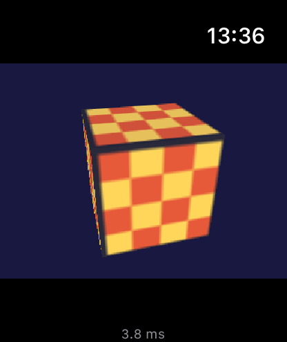

# Retro Apple Watch

Running Nintendo 64 games natively on an Apple Watch, starting with **Super Mario 64**.

This isn't an emulator. watchOS doesn't let apps generate code at runtime (no JIT), so a classic N64 emulator would be far too slow. Instead, the project builds the game from the community [decompilation](https://github.com/n64decomp/sm64) as ordinary C code, compiles it for the watch, and adds a small platform layer for graphics, sound and controls.

> **Status: early, but it runs.** Super Mario 64 builds for watchOS and plays in the Apple Watch simulator. Real watches haven't been tried yet, and performance there is the big unknown.

<p align="center">
  
</p>

*The test scene running in the Apple Watch simulator. Screenshots of the game itself aren't included, since they would be Nintendo's artwork.*

## How it works

```
 Super Mario 64 decomp (C)          ← external/sm64-port (git submodule)
        │  N64 display lists
        ▼
 gfx_pc.c  (display list → triangles, from the PC port)
        │
        ▼
 port/     ← this repo
   gfx_soft.c     software rasterizer (watchOS has no OpenGL or Vulkan)
   audio_watch.c  ring buffer → AVAudioEngine
   input_watch.c  touch / Digital Crown → N64 controller state
        │  320×240 frame, 30 fps
        ▼
 app/      SwiftUI watch app: shows frames, handles input and audio
```

The renderer draws the N64's native 320×240 on the CPU. The watch scales the picture up to fit the screen.

## Repository layout

| Path | What's in it |
|---|---|
| `port/src/` | The watchOS platform layer (C): renderer, audio, input |
| `port/game/` | Game glue: per-frame entry point and controller calls (built into the game library) |
| `port/demo/` | A test scene that needs no game data |
| `patches/` | Small hooks into the decomp, applied by `build-game.sh` (e.g. tap-to-point in the file select) |
| `app/` | The SwiftUI watch app and its [XcodeGen](https://github.com/yonaskolb/XcodeGen) project spec |
| `tools/render-preview/` | Runs the core on a Mac and writes a frame to an image, for quick renderer checks |
| `tools/build-game.sh` | Builds the game from your ROM into `build/watch/<sdk>/libsm64.a` |
| `tools/watch-cc.sh`, `tools/watch-ar.sh` | Wrappers that let the decomp's Makefile build for the watch |
| `external/sm64-port/` | The [SM64 PC port](https://github.com/sm64-port/sm64-port), as a submodule |

## Getting started

Requirements: a Mac with Xcode 26+ and the watchOS SDK, plus a few tools:

```sh
brew install xcodegen make aarch64-elf-binutils
```

(`make` installs GNU make 4 as `gmake`, since macOS ships 3.81. `aarch64-elf-binutils` provides the GNU assembler the decomp needs for one sound file.)

```sh
git clone --recursive https://github.com/TheSTouch/Retro-Apple-Watch.git
cd Retro-Apple-Watch

# 1. Put your ROM in place (see "Game data" below), then build the game:
tools/build-game.sh eu simulator      # or us / jp; "device" for real watches

# 2. Generate and open the Xcode project:
cd app && xcodegen && open RetroWatch.xcodeproj
```

There are two schemes:

- **RetroWatch** is the game. It needs step 1.
- **RetroWatchDemo** is a spinning test cube that needs no game data. Drag to spin it, tap to switch the texture.

Pick a scheme and an Apple Watch simulator, then run.

To check renderer changes without the simulator:

```sh
tools/render-preview/build.sh
build/render-preview build/frame.ppm 60
```

### On a real watch

```sh
tools/build-game.sh eu device          # arm64 + arm64_32, covers current and older watches
```

In Xcode, select the **RetroWatch** target, pick your team under *Signing & Capabilities*, choose your watch as the run destination, and run. The watch must be paired with an iPhone that's connected to the Mac, and have Developer Mode on (*Settings → Privacy & Security*).

## Game data: bring your own

This repository contains **no Nintendo code or assets** and never will. To build the game you need your own copy of Super Mario 64, preferably dumped from a cartridge you own. The decomp's build extracts the assets it needs from that file on your machine.

Supported versions, checked by SHA-1:

| Version | SHA-1 |
|---|---|
| US | `9bef1128717f958171a4afac3ed78ee2bb4e86ce` |
| Europe | `4ac5721683d0e0b6bbb561b58a71740845dceea9` |
| Japan | `8a20a5c83d6ceb0f0506cfc9fa20d8f438cafe51` |

Place it at `external/sm64-port/baserom.<us|eu|jp>.z64`. ROM files are git-ignored everywhere in this repo.

## Controls (first pass)

The watch screen tracks only one finger, so controls are a design problem in their own right.

| Input | N64 |
|---|---|
| Drag on the game image | Analog stick |
| Slide from the game image onto a button | That button, while the stick keeps its direction (a running jump is "drag, slide onto A") |
| A / B / Z buttons under the game | A (jump), B (punch), Z (crouch) |
| Tap the game image | A, or in the file select: point and click right there |
| Hold still on the game image for half a second, then lift | Start |
| Digital Crown | Camera (C-left / C-right) |

The game is 4:3, so on the watch's taller screen there's room for a button bar below it. watchOS tracks only one finger, which is why buttons are reached by sliding rather than with a second finger. R and C-up/C-down don't have a mapping yet. (watchOS's double-tap pinch was tried for jumping, but it lags about two seconds and doesn't fire while the screen is touched.)

## Roadmap

- [x] Software renderer implementing the PC port's rendering interface
- [x] SwiftUI watch app with touch, Digital Crown and audio plumbing
- [x] Test scene running on the watchOS simulator
- [x] Asset extraction from a user-supplied ROM
- [x] Build the game as a static library for the watch and run it in the simulator
- [ ] Run on a real watch and profile the renderer (the main performance risk)
- [ ] Design touch controls that work for actual gameplay
- [ ] Save files, pausing when the wrist drops, battery behavior

## Legal

Super Mario 64 is © Nintendo. This is a non-commercial hobby project and is not affiliated with or endorsed by Nintendo. The code in this repository is MIT licensed (see `LICENSE`). The decompilation and the PC port are separate projects under their own terms.
